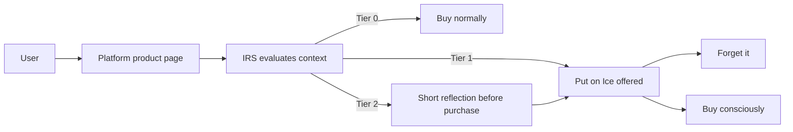
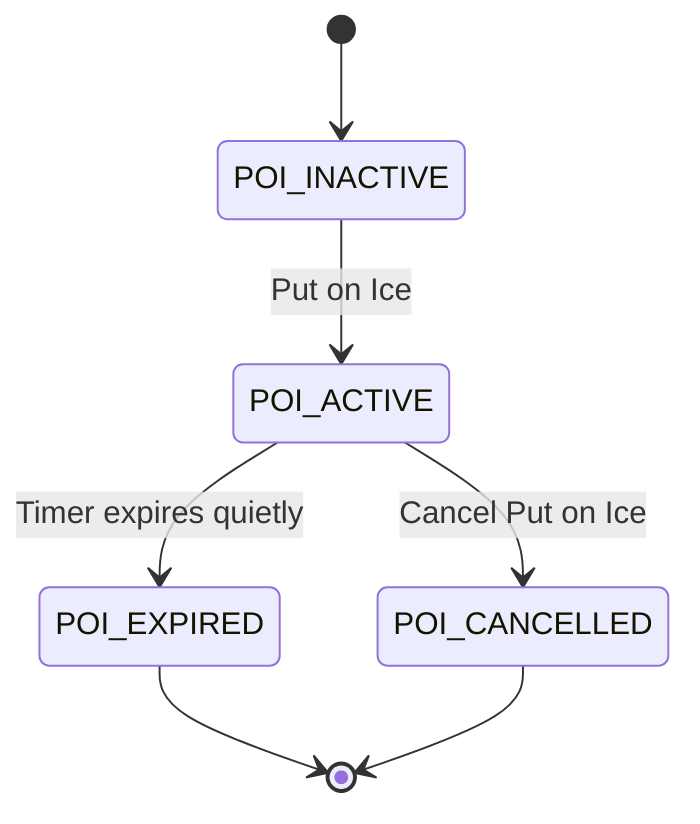

# ZenBuy MVP — How It Works

ZenBuy adds a short decision layer to an online-shopping page. It does not make a decision for the user; it makes an impulsive purchase visible, offers a cooling-off period, and preserves the freedom to buy consciously.

The MVP is **local-first**. Its Vault, Archive, Purchase History, and event log live in `chrome.storage.local` on the user’s laptop. Amazon is the current retailer target; the local sandbox implements the same adapter interface for safe testing.

## 1. Decision flow

**User → Platform → IRS → Put on Ice → Forget / Buy consciously.**

On a supported product page, ZenBuy reads the product title, price, category, product ID, and URL. It renders a small card immediately, then fills in the user’s work time and Impulse Risk Score (IRS).

| Tier | ZenBuy behavior | Purchase behavior |
| --- | --- | --- |
| Tier 0 | No intervention or POI button. | The normal retailer flow. |
| Tier 1 | Put on Ice (POI) is offered. | Add to Cart and Buy Now remain available. |
| Tier 2 | POI is offered; purchase controls look paused. | A real retailer purchase control opens a short reflection. The user can close it immediately; after 15 seconds they can continue the exact original action or use POI. |

“Continue” preserves the original intent: Add to Cart continues Add to Cart, and Buy Now continues Buy Now. ZenBuy does not intercept its own score controls, unrelated page areas, or browser navigation.

## 2. Put on Ice (POI)

The Vault contains active cooling-off decisions. The background worker persists the state; the lifecycle module owns state transitions and reconciles elapsed timers when ZenBuy next runs.

| State | Location | User can | ZenBuy prevents |
| --- | --- | --- | --- |
| `POI_INACTIVE` | Not yet tracked. | Buy normally or use POI when offered. | Nothing. |
| `POI_ACTIVE` | Vault. | Inspect it or **Cancel Put on Ice**. | Retailer purchase controls are locked. Hover text says “Cancel first”; cancelling is required before buying. |
| `POI_EXPIRED` | Decision Archive. | Rediscover it later in Archive or on its product page. | No expiry alert, pop-up, or automatic nudge. |
| `POI_CANCELLED` | Decision Archive. | Open its product page from Archive. | The Archive card has no immediate “Put on Ice again” action. |

Expiry is intentionally quiet. If a laptop is off, nothing has to wake it: the next popup open or supported-page visit moves elapsed POI items into Archive.

Purchase History is separate from Archive. Only a retailer **order-confirmation** page records a purchase; Add to Cart and Buy Now clicks are not purchase evidence. Confirmation IDs make recording idempotent, so page refreshes do not duplicate a purchase.

## 3. IRS: what affects the decision

Weighted IRS v1 owns its own 0–100 score, weights, thresholds, and tier mapping. A different IRS engine may use another scale as long as it returns the same final tiers.

1. **Product classification / necessity** — Gemini, when configured, estimates staple, practical, discretionary, or luxury; a deterministic fallback keeps ZenBuy working without an API response.
2. **Browsing velocity** — fast decisions and social/referral traffic raise risk; deliberate comparison and direct search lower it.
3. **Time of day** — late-night and fatigue periods raise risk relative to daytime browsing.
4. **Dark patterns** — scarcity wording, countdown/expiry pressure, social-proof pressure, and preselected checkboxes.
5. **Financial salience** — price relative to the user’s hourly wage, expressed as work time.

**Inspect Score** shows the mathematical breakdown and a dark-pattern detector. For every detector it shows Detected/Clear, the rule, and exact page text that matched; when available, it also shows stock context such as “In Stock.” This makes false positives visible instead of reducing them to a vague “Low stock / Scarcity” label.

## 4. TODO

- **Detect Buy Now Pay Later.** Find financing/BNPL offers and pass them into the financial IRS component.
- **Track acquisition source.** Record TikTok, other social, paid ad, organic search, email, or direct entry.
- **Add purchase history to IRS.** Use prior confirmed purchases—especially recent duplicates or similar items—as an explicit IRS signal. Local history and confirmation recording already exist; this input is not wired into IRS yet.
- **Price Search.** After expiry, search selected marketplaces, save results with the archived item, and allow a later refresh.

For trusted local development only, copy `config/config.example.js` to the ignored `config/config.local.js` and set a Gemini key there. Never commit or distribute that file. A public release requires a ZenBuy server endpoint that keeps the Gemini key as a server-side secret and applies authentication, quotas, and rate limits.

Run the automated checks with `npm test`. They cover IRS contracts, engine-specific arithmetic, Vault transitions, adapter compatibility, and the full extension against the local sandbox—without buying anything.
